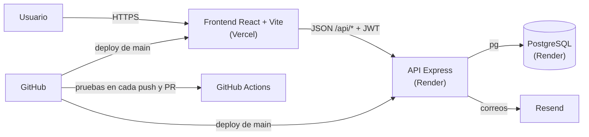

# SIPU

SIPU (Sistema de Intermediación de Prácticas Universitarias) es una plataforma de intermediación laboral que inicia enfocada en prácticas estudiantiles y evolucionará hacia una bolsa de empleo general y, posteriormente, una agencia pública de empleo.

## Estado del proyecto

La **Fase 0 — Base técnica** está preparada: el monorepo incluye un frontend React/Vite, una API Express, documentación de ejecución local y un esquema inicial de PostgreSQL. La **Fase 1** queda cerrada y verificada con autenticación real, gestión de ofertas y flujo de postulaciones para estudiantes y empresas. La **Fase 2** se inicia con la preparación del perfil de candidato externo y la conexión de sus datos al backend. La **Fase 3** queda completa con la bolsa de empleo general: ofertas de empleo, verificación de organizaciones y recomendación de ofertas según perfil. La **Fase 4** añade convocatorias públicas y estadísticas de empleo. La **Fase 5 — Calidad** corrige el fallo de carga tras iniciar sesión en Vercel, da función a los botones pendientes, endurece la seguridad de la API y añade pruebas automatizadas. La **Fase 6** guarda la hoja de vida en la base de datos, permite subir CV y foto, recuperar la contraseña por correo y publicar ofertas de formación. La **Fase 7** añade la verificación documental de empresas: la empresa adjunta su RUT y su certificado de Cámara de Comercio y envía una solicitud, y el administrador la revisa en una bandeja de solicitudes. También añade cabeceras de seguridad, el cierre ordenado del servidor e integración continua. Después, la revisión de estructura organiza el frontend por funcionalidades, con los mismos nombres que los módulos del backend, y agrega pruebas que vigilan las dependencias entre capas y las constantes que comparten frontend y backend. La guía está en [`docs/arquitectura.md`](docs/arquitectura.md). La **Fase 8** convierte la creación de ofertas en un formulario por pasos con opciones y vista previa, hace que cada postulación conserve la hoja de vida con que se envió (antes cambiaba al editar el CV del perfil) y añade un proceso de selección con tablero por etapas, citación a entrevista, mensajes, notas internas y calificación (145 pruebas en el backend y 99 en el frontend).

## Verificación de cierre de la Fase 1

Se validaron en la API desplegada los flujos principales del MVP:

- registro de empresa y publicación de una oferta;
- registro de estudiante y envío de postulación a una oferta;
- consulta de postulaciones desde el perfil del estudiante;
- consulta de postulaciones recibidas desde el perfil de la empresa.

La verificación real devolvió respuestas `ok: true` y confirmación de creación de usuarios, ofertas y aplicaciones en PostgreSQL.

## Estructura

```text
.
├── .github/workflows/    # Integración continua (pruebas de backend y frontend)
├── frontend/             # Aplicación React + Vite + Tailwind
├── backend/              # API Express y esquema PostgreSQL
├── docs/                 # Documentación técnica y de producto vigente
├── Proyecto-Archivos/    # Materiales y entregables de referencia
└── .gitattributes        # Finales de línea LF en todos los sistemas
```

## Producto desplegado

| Componente | Servicio | URL |
| --- | --- | --- |
| Aplicación web | Vercel | URL_VERCEL |
| API REST | Render (Web Service) | https://proyecto-ingsoftware-m4f3.onrender.com/api |
| Base de datos | Render (PostgreSQL) | Privada, solo la usa la API |

Para comprobar el despliegue:

- `https://proyecto-ingsoftware-m4f3.onrender.com/api/health` responde `{"service":"sipu-backend","status":"ok"}`.
- `https://proyecto-ingsoftware-m4f3.onrender.com/api/db-check` responde `{"ok":true,...}` cuando la API llega a la base.

El plan gratuito de Render apaga la API tras 15 minutos sin uso; la primera petición después tarda cerca de un minuto. La guía de despliegue está en [`docs/despliegue-render-vercel.md`](docs/despliegue-render-vercel.md).

## Arquitectura



El diagrama completo, las capas de cada lado y las reglas entre ellas están en [`docs/arquitectura.md`](docs/arquitectura.md).

## Instalación en un computador nuevo

Esta guía deja la aplicación funcionando en local, con su propia base de datos.

### 1. Instalar las herramientas

| Herramienta | Versión | Para qué |
| --- | --- | --- |
| [Git](https://git-scm.com/downloads) | cualquiera reciente | Descargar el código |
| [Node.js](https://nodejs.org/) (incluye npm) | 20 o superior (npm 10 o superior) | Ejecutar la API y el frontend |
| [PostgreSQL](https://www.postgresql.org/download/) | 15 o superior | Base de datos. Anote la contraseña del usuario `postgres` que pide el instalador. |
| pgAdmin (opcional) | viene con el instalador de PostgreSQL en Windows | Ver las tablas con interfaz gráfica |

Compruebe las versiones en una terminal:

```bash
git --version
node --version
npm --version
psql --version
```

En Windows, si `psql` no se reconoce, agregue `C:\Program Files\PostgreSQL\<versión>\bin` a la variable `Path` o use pgAdmin en el paso 3.

### 2. Descargar el código

```bash
git clone https://github.com/Mund1to/Proyecto-IngSoftware.git
cd Proyecto-IngSoftware
```

### 3. Crear la base de datos

Cree una base vacía llamada `sipu`:

```bash
psql -U postgres -c "CREATE DATABASE sipu;"
```

Con pgAdmin: clic derecho en **Databases** → **Create** → **Database...** → nombre `sipu`.

No hace falta crear tablas: la API crea el esquema y aplica las migraciones la primera vez que arranca.

### 4. Configurar la API

Copie el archivo de variables de ejemplo:

```bash
cd backend
cp .env.example .env              # macOS, Linux o Git Bash
copy .env.example .env            # Windows (cmd)
Copy-Item .env.example .env       # Windows (PowerShell)
```

Abra `backend/.env` y ajuste al menos estas dos variables:

| Variable | Valor |
| --- | --- |
| `DATABASE_URL` | `postgresql://postgres:<su-contraseña>@localhost:5432/sipu` |
| `JWT_SECRET` | Cualquier texto largo y aleatorio. Para generarlo: `node -e "console.log(require('crypto').randomBytes(48).toString('hex'))"` |

Las demás pueden quedar como están. Sin `RESEND_API_KEY` no se envían correos: el enlace de recuperación de contraseña se muestra en la consola de la API. La tabla completa de variables está en [`backend/README.md`](backend/README.md).

### 5. Iniciar la API

En la misma terminal, dentro de `backend`:

```bash
npm install
npm run dev
```

La consola debe mostrar `Schema created successfully` la primera vez y luego `SIPU backend listening on port 3000`. Compruébelo en `http://localhost:3000/api/health` y `http://localhost:3000/api/db-check`.

### 6. Iniciar el frontend

Abra una segunda terminal desde la raíz del repositorio:

```bash
cd frontend
npm install
npm run dev
```

Abra la URL que muestra Vite, normalmente `http://localhost:5173`. En desarrollo el frontend usa `http://localhost:3000/api`; para apuntar a otra API, cree `frontend/.env.local` con `VITE_API_URL=<url-de-la-api>/api`.

### 7. Crear el primer administrador

El registro público solo otorga el rol `USUARIO`. Registre una cuenta desde la aplicación y, en la carpeta `backend`, ejecute:

```bash
npm run grant-role -- correo@dominio.com ADMINISTRADOR
```

Cierre sesión y vuelva a entrar. Desde la pantalla **Usuarios**, el administrador asigna los demás roles.

### 8. Ejecutar las pruebas

```bash
cd backend
npm test        # 221 pruebas de la API contra PostgreSQL, incluidas 71 extremas

cd ../frontend
npm run typecheck
npm test        # 158 pruebas con Vitest y Testing Library, incluidas 55 extremas y las de arquitectura y contrato
```

Las pruebas del backend crean solas una base aparte cuyo nombre termina en `_test` (por defecto `sipu_test`) y la vacían en cada ejecución; nunca tocan la base `sipu`. Para usar otra, defina `TEST_DATABASE_URL` en `backend/.env`. GitHub Actions (`.github/workflows/ci.yml`) ejecuta estas pruebas, el typecheck y el build en cada push a `main` o `develop` y en cada pull request.

### Problemas frecuentes

| Síntoma | Causa y solución |
| --- | --- |
| `password authentication failed for user "postgres"` | La contraseña de `DATABASE_URL` no coincide con la de PostgreSQL. |
| `database "sipu" does not exist` | Falta el paso 3. |
| `ECONNREFUSED 127.0.0.1:5432` | PostgreSQL no está encendido. En Windows, inicie el servicio `postgresql-x64-<versión>` desde **Servicios**. |
| `EADDRINUSE :::3000` | Otro proceso usa el puerto 3000. Ciérrelo o cambie `PORT` en `.env`. |
| El frontend muestra "No se pudo conectar con el servidor" | La API no está corriendo o `VITE_API_URL` apunta a otra dirección. |
| No llega el correo de recuperación | Sin `RESEND_API_KEY` el enlace aparece en la consola de la API. |

### Estructura de la base de datos

Consulte [`docs/database-schema.md`](docs/database-schema.md) para el modelo y las decisiones de diseño. Las tablas se crean desde `backend/database/schema.sql`, y los cambios posteriores van en migraciones idempotentes en `backend/database/migrations/`.

## Documentación

- [Wiki del proyecto](https://github.com/Mund1to/Proyecto-IngSoftware/wiki): historias de usuario, requerimientos, diagramas, riesgos, arquitectura, instalación, despliegue y pruebas.
- [`docs/arquitectura.md`](docs/arquitectura.md): diagramas de despliegue y de una petición, estructura, reglas entre capas y qué tocar para cambiar de tecnología.
- [`frontend/README.md`](frontend/README.md): comandos y estructura del cliente web.
- [`backend/README.md`](backend/README.md): ejecución de la API y endpoint de salud.
- [`docs/historial-desarrollo.md`](docs/historial-desarrollo.md): guía paso a paso de lo realizado y cómo continuar.
- [`docs/informe-actualizacion-roles-ofertas.md`](docs/informe-actualizacion-roles-ofertas.md): cambios de roles, ofertas, permisos, validaciones y actualización de base de datos.
- [`docs/informe-cierre-fase-3.md`](docs/informe-cierre-fase-3.md): cierre de la Fase 3 con verificación de organizaciones y recomendación de ofertas.
- [`docs/informe-cierre-fase-4.md`](docs/informe-cierre-fase-4.md): cierre de la Fase 4 con convocatorias públicas y estadísticas de empleo.
- [`docs/informe-fase-5-calidad.md`](docs/informe-fase-5-calidad.md): auditoría de calidad, corrección del login en Vercel y pruebas automatizadas.
- [`docs/informe-fase-6-perfil-archivos.md`](docs/informe-fase-6-perfil-archivos.md): hoja de vida, archivos, recuperación de contraseña y formación.
- [`docs/informe-fase-7-verificacion-documental.md`](docs/informe-fase-7-verificacion-documental.md): verificación documental de empresas, bandeja de solicitudes y sugerencias.
- [`docs/informe-estructura-escalable.md`](docs/informe-estructura-escalable.md): archivos redundantes, frontend por funcionalidades y pendientes.
- [`docs/informe-fase-8-ofertas-seleccion.md`](docs/informe-fase-8-ofertas-seleccion.md): formulario de oferta por pasos, hoja de vida por postulación y proceso de selección.
- [`docs/despliegue-render-vercel.md`](docs/despliegue-render-vercel.md): despliegue de PostgreSQL y API en Render, y frontend en Vercel.
- [`docs/backlog-fases.md`](docs/backlog-fases.md): fases, historias de usuario y prioridades.
- [`docs/database-schema.md`](docs/database-schema.md): modelo PostgreSQL inicial.

## Alcance por fases

- **Fase 0:** base técnica del monorepo, frontend, backend y PostgreSQL.
- **Fase 1:** MVP de prácticas para estudiantes y empresas.
- **Fase 2:** registro y postulación de candidatos externos.
- **Fase 3:** bolsa de empleo general y verificación de empleadores.
- **Fase 4:** convocatorias y estadísticas de empleo público.
- **Fase 5:** calidad, seguridad y pruebas automatizadas.
- **Fase 6:** hoja de vida en base de datos, archivos, recuperación de contraseña y formación.
- **Fase 7:** verificación documental de empresas y bandeja de solicitudes para el administrador.
- **Fase 8:** ofertas con opciones, hoja de vida por postulación y proceso de selección con entrevistas.

## Modelo de usuarios

El sistema separa usuarios, perfiles y roles. Los perfiles iniciales son estudiante, candidato externo y empresa u organización. También existen permisos administrativos y, en fases posteriores, permisos para funcionarios públicos.

## Gestión del trabajo

Las issues del desarrollo se gestionan en GitHub:

- https://github.com/Mund1to/Proyecto-IngSoftware/issues
